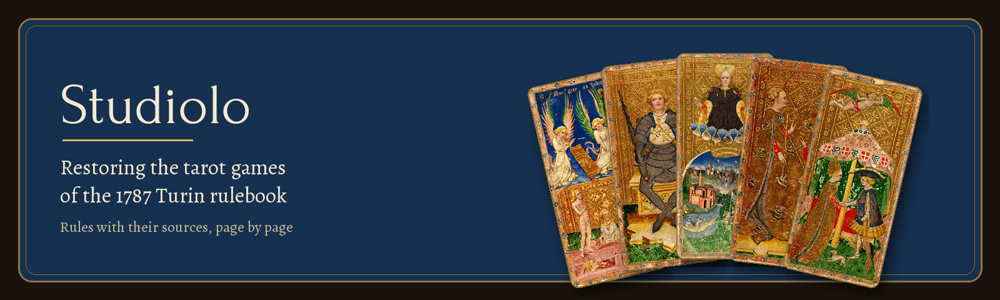

# Studiolo

**An open notebook on restoring the tarot card games of the 1787 Turin rulebook.**

[](https://doi.org/10.5281/zenodo.24476760)

Tarot cards were made for play. In 1787 the Turin printer Soffietti published *Primi elementi e regole del giuoco de' tarocchi*: a hundred pages of rules for the tarot games then played in Piedmont, for two to seven players. The pages do not say everything.

Studiolo is our attempt to make every game of that book playable again, and to show our working while we do it.

## How to read our rules

Every rule we write down carries its source, its page, and one of three marks.

| Mark | Meaning |
|---|---|
| **[D] documented** | The rule is printed in the named source. |
| **[R] our reading** | The source is ambiguous, or two sources disagree. This is how we read it. |
| **[S] sources silent** | No source we hold says anything. This is our decision, made so that the game can be played. |

A rule marked [R] or [S] is a placeholder, not history. Where a dispute matters for play, the rule also records the alternative we did not take and what could settle the question: a document, an expert, mathematics, statistics from bots, or people at a table.

It is the restorer's rule applied to games: what we add must be recognisable as ours, and the original must stay at hand.

## Where we stand

Rules revision 14, November 2026 (release 1, with its DOI, holds revision 4):

- 21 game files: one per game, and one per number of players where the deal differs.
- 988 rules: 563 documented, 329 our readings, 96 where the sources are silent.
- 38 questions on the list: 15 still open, 15 settled by a decision of the project, 8 closed.
- The rules engine plays all 21 game files today. The rules engine, the bots and the bot lab are in this repository.

## What is here

| Part | What it is |
|---|---|
| [`rules/`](rules/) | The rules of every game in plain English. Start here. The pages are generated from the rule files by the code that draws the rules pages of our site; where that code has no sentence yet, a value is printed as the file has it. |
| [`rulesets/`](rulesets/) | The rule files themselves, machine-readable, with their schema. |
| [`rulesets/REVISIONS.md`](rulesets/REVISIONS.md) | The journal: every change to every rule, numbered, with its reason. |
| [`rulesets/OPEN_QUESTIONS.md`](rulesets/OPEN_QUESTIONS.md) | The placeholders, each with its alternatives and with how often the disputed case comes up in play. |
| [`QUESTIONS.md`](QUESTIONS.md) | Where we are stuck, in plain words: two books we are looking for, six passages we could not settle, and the problems that wait for a calculation or a program. |
| [`method/`](method/) | How we look for sources, read them, turn them into rules, and test the result with robots. |
| [`docs/`](docs/) | The format of a rule file, and the rules it cannot express yet; how the engine and the bots work. |
| [`core/`](core/) | The rules engine: it reads a rule file and plays a hand by those rules. It knows no game by name. |
| [`bots/`](bots/) | The bots: a random robot and three levels of a simple bot. They are plain on purpose. |
| [`tools/`](tools/) | The commands that play a hand, run the robots, measure one bot against another, and check the rule files. |
| [`test/`](test/) | The tests of the engine, the bots and the tools. |
| [`examples/`](examples/) | Worked examples: a rule file, a played hand, a measurement, a check of the deal. |
| [`problems/`](problems/) | Open problems for people who program or count, each with the commands to start. |

The journal and the documents name commands and tools. Most of them are here now, so that anyone can repeat our numbers. A few are not: they need parts that are not in this repository.

## Run the engine

You need Node 24. The engine has no dependencies: there is nothing to install.

```
npm run play    -- sedici_2 --seats 2 --seed demo --bots normal,easy
npm run robots  -- --games sedici_2:2 --deals 20 --seed demo
npm run botlab  -- --games sedici_2:2 --a normal --b easy --deals 20 --seed demo
```

- `npm run play` plays one hand of a game and prints the deal, every move, the result and the money. The start and the end of the output:

  ```
  game sedici_2, rules revision 11, 2 seats
  seed demo, hand 0, hand seed demo:sedici_2:2:0, dealer seat 0
  seat 0: normal
  seat 1: easy
  deal
    seat 0: swords:1 batons:10 coins:1 T18
    seat 1: batons:Q coins:7 T10 T14
    undealt: 70 cards
  moves
     1  seat 1  play coins:7
     2  seat 0  play coins:1
          trick won by seat 0 (coins:7 coins:1)
     ...
    33  seat 1  claim_fuora
          fuora_claimed {"seat":1,"valid":true,"points":20}
  result
    outcome: win (fuora)
    winners: seat 1
    points: side 0 72, side 1 240
    payments: seat 0 to seat 1 1 (loser_pays_winner)
    money: seat 0 -1, seat 1 +1 (sum 0)
    checksum 8fbe8a8046d693ea
  ```

- `npm run robots` plays many hands with a random robot and checks that the engine kept its rules. It prints one line per game, with a count for each kind of failure:

  ```
  game      seats  hands  actions  invariant  recount  secrecy  replay  refused-legal  illegal tried/refused  ms/hand
  sedici_2  2      21     631      0          0        0        0       0              6/6                    17.53
  failures: 0; written <WORK>/robots_core.json
  ```

- `npm run botlab` plays one bot against another on the same hands and prints the share of hands won, with its interval, and the money per hand:

  ```
  sedici_2:2 normal vs easy hands 20 share 0.600 [0.387..0.781] fair 0.500 margin 0.5 decisions 582 | money 0.200 [-0.241..0.641] per hand, thrown in 0.000, no declarer, contracts {}, a minus the others 0.400 [-0.482..1.282]
  written <WORK>/botlab/normal_vs_easy.json 5 s
  ```

The hands are fixed by the seed and the number of the hand, so the same command gives the same numbers each time (the times, `ms/hand` and `s`, change from machine to machine). The bots are simple on purpose and are not meant to be strong. A number from the lab says how the bots behave under our readings, not what the game was in 1787.

[`docs/ENGINE.md`](docs/ENGINE.md) explains the engine in ten minutes. [`docs/BOT.md`](docs/BOT.md) and [`docs/CORE_API.md`](docs/CORE_API.md) give the contracts of the bots and of the core.

## Our mistakes stay in the record

In revision 1 we misread rule 38 of the book (p. 34). No honour may be discarded, *«eccetto che Bagatto sia solo, senza il Folle»*. We took this to mean "unless the hand holds no Fool". It means: unless the Bagatto is the only trump in the hand and there is no Fool. That is how Michael Dummett reads the rule (*The Game of Tarot*, 1980, p. 259). Revision 2 corrects it. The journal keeps both readings and the reason for the change.

Revision 5 corrects nine wrong or doubtful attributions of sources that a second reading of the pages found. One of them was a penalty written the wrong way round: at Venticinque for three the offender pays each opponent, he does not receive from them (Prammatica [1846], p. 14). The journal lists them.

Revisions 6 and 7 make the rest of the book playable. Sedici and Trent'uno become a race to five points, after Prammatica [1846], pp. 11-13. Permesso gets its auction and its exchange of called cards, Chiamare il Re its secret partner, Bagatt'ultimo and Mitigati their declarations. Where the pages are silent — who receives which laid card, what the dealer's pass means, how long a match lasts — the file carries a placeholder with its mark and the other reading, and the question stands in the list.

Revision 8 is a second reading. The thirteen game files of revisions 6 and 7 were read again against the page images. Three scans sent by the Turin Academy of Sciences were read with them: the two pages missing from our copy of the book of [1846], the separate booklet of the *Prammatica*, and *La partia a taroch an quatr* (Turin, 1880). The reading found more than sixty points to correct. Two of them change who deals: at Baronetti the loser deals the next game (1787, pp. 41 and 47), and at Trent'uno for three and four the deal goes round to the right (pp. 19 and 42). Mitigati for two gains the words «Ho scartato» before the declarations, and Trent'uno a variant after the *Prammatica*, in which the Fool beats the Bagatto. The rest are pages, quotations and marks. The revision also corrects our own count: sixteen leaves kept only for comparison with an older format had been counted as rules where the sources are silent. Without them revision 7 had 908 rules, not 924.

Revision 9 follows two independent outside checks of revision 8. Each remark was checked against the page images or reproduced on the engine, and the pages that decide a point were read twice, the second time by a reader who had not seen the first reading. About two thirds of the remarks held. Three of them change the play of the short games. At Sedici, Trent'uno and Baronetti for two the deal alternates (1787, pp. 42-43, rule 44): the reading of revision 8, that the loser deals, is withdrawn. «Fuora» may be said on any turn of one's own (p. 40). At Baronetti the Fool is played into a trick in place of a card (pp. 50 and 54). In the games for three and four the card given for the Fool goes to the player who took the trick (Torino [1846], part I, p. 33), and Partita counted by four makes 72 points, with 36 each a tie. The rules pages had errors of their own: they said «half a point more» where the count takes half a point off, and 43 links gave a page of the book of 1787 under the name of another book. These are corrected, and a check now runs over every game, variant and option. Two questions came out of the check and stay open: how the book counted the cards left over at Venticinque, where its own example makes a tie that our count cannot produce, and where the steps of the payment at Permesso fall, on which two rules of the book disagree.

Revision 10 plays what revision 9 had to leave on paper. The format gained three words: a result shared by the players level on the best score, a payment made once at the end of a match, and a rounding toward zero. At Meno one player pays, the one with the most points (Torino [1846], part I, p. 32), and players level on the fewest points all win; the sources are silent on that tie, and the other readings stay in the file. The two short forms of Meno of the book of 1787 (p. 78) are played again, each only at the numbers of players where a check of two hundred hands found a winner often enough. In Partita for four (the variant of four deals), in Consiglio (the sum of four deals) and in Venticinque for three one stake is paid once, at the end of the match (Torino [1846], part I, pp. 34-36). The five games for two play move for move as in revision 9: on fixed seeds the 1,700 checksums of hands and matches are the same. The revision also writes down the readings found since: the discard and the revoke at Venticinque, the steps of the payment at Permesso, and the Milanese almanac «Per chi tarocca» for 1794 as a neighbouring support.

Revision 11 follows an outside check of all 21 game files against the books. Each remark was read against the page images or reproduced on the engine. At Sedici and Trent'uno a player says «fuora» of his own will: the book of 1787 prints no duty to say it at the end of a packet (pp. 39, 40, 46), and the old duty stays as the other reading. When the pack runs out, each player in turn may say it or pass; the books are silent on an empty pack, so that last window is our decision. The reprint of 1846 gives the game to the first player who made the points, not to the first who says so (*Prammatica*, p. 12, of Sedici and Trent'uno alike): Trent'uno plays that in its variant of 1846, Sedici keeps it as the other reading. Sedici for three plays «a scaricare»: the first out lays his cards down unseen, the other two play on, and the last pays for both (1787, pp. 43-44). At Meno with eight cards the player who takes every trick wins alone and all the others pay him (Torino [1846], part I, p. 32). At Bagatt'ultimo a player who declares Mitigati is paid ten for the three honours and ten more for Mitigati (1787, p. 94). At Mitigati for two the declarations are made until the first trick is covered (p. 86). At Permesso for six and seven a free game agreed beforehand has no auction and counts by one, two or three cards, as the table agrees (pp. 75-77); the second reading of the auction, where the word goes back at once to the player who was overbid (pp. 62-63, 82), is in the files as the other reading. At Baronetti the loser deals the next game (p. 41). The other reading of the discard at Venticinque for two, counted for nobody, now plays (pp. 53-55). One reason we had written ourselves was wrong and is gone: at Consiglio 46 points can be made counting by four, so the count in pairs is a reading, not a necessity. Still not played: the duty of a player who is «fuori» at Venticinque for three to lead his trumps (Torino [1846], part I, p. 34); the journal says why. The bots follow the new rules, and two defects found by an outside check are corrected: a bot no longer misses a card that wins at once at Sedici and Trent'uno, and it weighs a lawful equal bid at Permesso.

Revision 12 plays the last point of that check that was still on paper. At Venticinque for three, a player who can no longer lose the match — in the last deal, with a running total above 26 — must lead a trump when the lead is his: «Se avrà ancora dei Trionfi è obbligato a trionfare» (Torino [1846], part I, p. 34). Without a trump he leads a king; that, the Fool not counting as a trump, and the moment when a player is out are our readings, and the files say so. The sure cards and the impartial giving of tricks stay a duty of the player, not a rule of the cards. The reprint prints a penalty of five points to each opponent for breaking the duty (*Prammatica*, p. 14); the engine simply does not accept another card.

Revision 13 changes no rule and no mark. Six source lines named notes of the project that are not part of this record; the references are removed, and the journal lists the files.

Revision 14 follows a third outside check: of the 21 game files, the engine and the rules pages against the books. Each remark was read against the page images or reproduced on the engine; of the 208 remarks on the game files, 110 held in full and 70 in part. One rule changes its value. A plain card counted one by one is worth 1 at Sedici and in the form of four cards of Meno, not 0: the Turin book of 1846 speaks of Sedici and Trent'uno in one sentence (*Prammatica*, p. 12; Torino [1846], part I, pp. 30 and 37), and until now our Sedici counted 0 and our Trent'uno 1. The value 0 stays as the other reading. The same reading closes a problem we had put to others: in the short form of Meno for three, 44 % of the hands ended with several winners, and we asked whether that was the game or our misreading. With a plain card worth 1 it is 21.5 %. The engine had errors of its own that a player could see. At Mitigati for two a declaration made after one's own first card was counted without that card (1787, p. 86). The Fool was exchanged for a card between two partners of one side. The lines of the score on the table did not always add up to its total. Counted by threes, a hand in which the owner of the Fool took no trick made 79 points out of a pack of 78. These are repaired, and the journal describes each. On the first reading of the check we were ready to change two more values, and to take the Fool and the discard from a player who took no trick, after the *Prammatica* of 1846. A second reading, made to refute the first, went back to the book of 1787, which as we read it lets him keep both (pp. 21 and 50). The values stay, and the rule of 1846 stands beside them as the other reading. The revision also says when we count a game as finished, and what can still change a finished rule: a new document, the argument of a specialist, or a defect met by a live player.

## How you can help

- **You know a source we lack.** We list what we are looking for.
- **You read a passage differently.** Tell us, with the page.
- **You play these games.** Tell us how your table rules the cases the book leaves open.
- **You are a mathematician.** Some open questions wait for a calculation, not for a document.

[`QUESTIONS.md`](QUESTIONS.md) gathers the questions on which we are stuck now. The Discussions tab is the place; [`CONTRIBUTING.md`](CONTRIBUTING.md) says what helps us most. We answer.

## What we do not claim

- The book describes Piedmont in 1787. It is not evidence of how tarot was played in Milan in the 1440s.
- We are not the first to study these games. Before us: Michael Dummett, *The Game of Tarot* (1980); Michael Dummett and John McLeod, *A History of Games Played with the Tarot Pack* (2004); John McLeod's pagat.com.
- A game that runs is not thereby correct. Robots tell us whether a reading can be played, not whether it is true.

## Sources

- *Primi elementi e regole del giuoco de' tarocchi*, Torino, Soffietti, 1787. We work from a study copy that the Biblioteca Sormani (Milan) supplied free of charge through the IHR Library, University of London. We may not pass the scan on. Ask the library: that is how we got ours.
- L. B., *Il giuocatore di tarocchi al tavoliere*, Torino, Serra, [1846].
- Michael Dummett, *The Game of Tarot*, London: Duckworth, 1980, chapter XIII, «Tarocco in Piedmont and Lombardy».

We quote short passages with their page numbers. We do not publish scans that we have no right to publish.

## How we work, and where the AI is

Petri Games is a small studio. Reading the scans, writing the rule files, building the test robots and drafting most of these texts is done with an AI system (Claude, by Anthropic), directed by Evgeny Tsaplin, the founder of the studio, who makes the decisions. That is the reason every rule carries a page number: you do not have to trust us, or the machine. Open the page.

## Play the games

- **Studiolo, the site**: play in the browser, with friends by a link or against bots. Every game of the book can be played: 21 game files, 28 tables by the number of players. <https://studiolo.petrigames.com/?from=github>
- **TRIONFI** on Steam: our card game played with the Cary-Yale Visconti deck. <https://store.steampowered.com/app/5504420/?utm_source=github&utm_campaign=studiolo>

## Licence and citation

This repository has two licences, one for code and one for texts.

| What | Licence |
|---|---|
| `core/`, `bots/`, `tools/`, `test/`, `package.json`, the code and level files in `examples/` (`*.mjs`, `*.json`) | MIT, see [`LICENSE-CODE`](LICENSE-CODE) |
| `rulesets/`, `rules/`, `docs/`, `method/`, the texts in `examples/` (`*.md`), `problems/`, and our other texts | [CC BY 4.0](LICENSE) |
| Quotations from the sources, the cards in the banner | Not ours; see below |

Use the texts and rule files freely, name us, and link here. The code may be used, changed and passed on under the terms of the MIT licence.

Two things are not ours to license. The quotations from the sources belong to their authors and publishers. The cards in the banner are «Cary-Yale Visconti tarocchi, Milan, 1440s. Beinecke Library, Yale University (open access)».

Suggested citation: Tsaplin, E. (2026). *Studiolo: the tarot games of the 1787 Turin rulebook* (release 1, rules revision 4). Zenodo. <https://doi.org/10.5281/zenodo.24476761>. See [`CITATION.cff`](CITATION.cff).

Each release is archived at Zenodo under its own DOI: name the release and the rules revision you used. One permanent DOI always leads to the latest release: <https://doi.org/10.5281/zenodo.24476760>.
